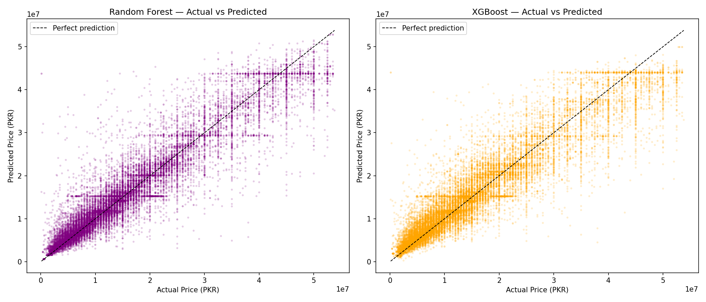

# Real Estate AI

Real Estate AI is a small machine learning project for analysing property listings (the dataset covers Pakistani cities). It cleans a raw housing dataset, trains price prediction models, and uses those models in a Streamlit app to estimate fair prices and recommend potentially attractive properties within a budget.

Built for the AI/ML course at TAMK (2026).

## Results

Held-out test set, same split for both models:

| Model | R² | MAE (PKR) | RMSE (PKR) |
|---|---|---|---|
| Random Forest | **0.885** | **2.46M** | **4.00M** |
| XGBoost | 0.866 | 2.84M | 4.32M |

Random Forest won on all three metrics with no extra tuning, so the app uses it.



## Known limitation

A location the model never saw in training is not rejected. In `src/recommend.py` an unseen
value falls back to the first class of the label encoder (alphabetically first), so the app
silently prices it as a different neighbourhood. The honest fix is to refuse the prediction,
or fall back to a city-level estimate and say so on screen. I've kept the behaviour as-is
here because it's a good example of how a tabular model quietly fails the users it doesn't know.

## What it does

- Predicts a property's estimated price from features such as city, location, property type, bedrooms, bathrooms, and area.
- Recommends listings that fit a user's budget and minimum requirements.
- Shows a ranked table of opportunities and simple comparison charts in the web app.
- Includes preprocessing, training, and evaluation scripts for experimentation.

## Project Structure

- `app.py` - Streamlit app for price prediction and investment recommendations.
- `src/preprocess.py` - data cleaning, area conversion, and train/test preparation.
- `src/recommend.py` - recommendation logic and price prediction helper functions.
- `src/train.py` - trains a Random Forest model and saves it to `models/rf_model.pkl`.
- `src/train_xgb.py` - trains an XGBoost model and compares it with Random Forest.
- `src/evaluate.py` - helper script for model evaluation.
- `data/raw/pakistan_properties.csv` - input dataset used by the pipeline.
- `models/` - saved models and generated plots.

## Requirements

- Python 3.10 or newer is recommended.
- Install the project dependencies listed in `requirements.txt`.

## Setup

From the project root, create and activate a virtual environment, then install dependencies:

```bash
python -m venv .venv
.venv\Scripts\activate
pip install -r requirements.txt
```

## Get The Data

The dataset isn't committed (45 MB). Download it from
[Kaggle](https://www.kaggle.com/datasets/sarcasmos/pakistan-house-prices-and-property-listings)
and save it as `data/raw/pakistan_properties.csv`.

## Train The Models

The trained model files are not committed (the Random Forest is ~280 MB), so train the Random Forest model first:

```bash
python src/train.py
```

To train and compare the XGBoost model as well:

```bash
python src/train_xgb.py
```

These scripts will read the raw dataset, create the cleaned training data, and save model artifacts into `models/`.

## Run The App

Start the Streamlit interface with:

```bash
streamlit run app.py
```

Then open the local URL printed in the terminal, usually `http://localhost:8501`.

## How To Use

1. Choose a city, property type, budget, and minimum property features from the sidebar.
2. Click `Find Best Investments` to see recommended listings.
3. Use the price predictor section to estimate a fair price for a single property.

## Notes

- The app expects the trained model files in `models/`, especially `rf_model.pkl` and `label_encoders.pkl`.
- If you change the preprocessing logic, retrain the models before running the app again.

## License

MIT. The dataset has its own terms on Kaggle and OpenData Pakistan.
